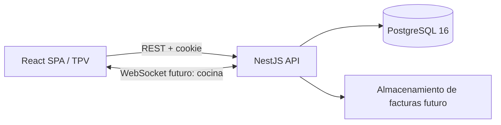
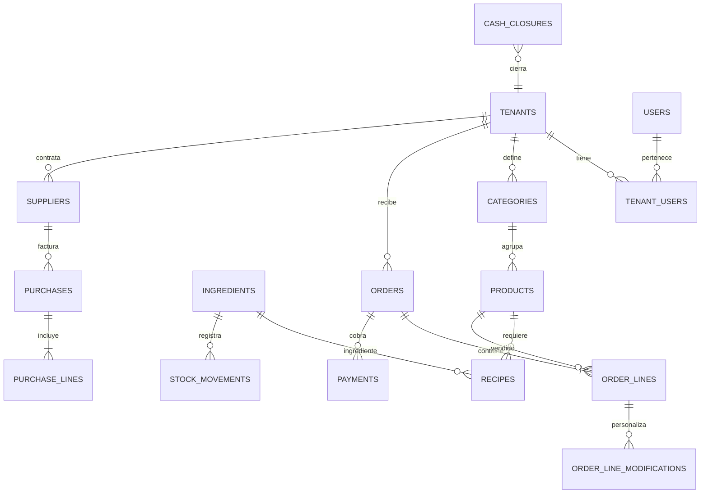

# Arquitectura y modelo funcional

## Componentes

La API está organizada por autenticación, catálogo, pedidos, inventario, compras y finanzas. Las operaciones de escritura relacionadas se ejecutan en una única transacción PostgreSQL. El frontend nunca calcula importes como fuente de verdad: el servidor obtiene producto, precio e IVA del catálogo.

## ER resumido

Las tablas con datos de local tienen `tenant_id`; la mayor parte usa PK compuesta `(tenant_id,id)` y las relaciones FK compuestas para impedir asociaciones entre locales. `users` es identidad global y `tenant_users` determina pertenencia y rol. La sesión selecciona el local de trabajo. `product_allowed_ingredients` define qué extras se pueden añadir a cada plato; `order_line_modifications` registra los ingredientes añadidos o retirados en una línea y permite que el cierre calcule el consumo real ajustado.

## Aislamiento y autorización

1. `POST /auth/login` recibe `tenant` (slug), email y contraseña. Se busca el tenant y se valida el usuario miembro dentro del contexto RLS.
2. Se crea una sesión server-side en PostgreSQL y se envía su identificador en cookie HttpOnly. No se acepta el `tenant_id` enviado por el cliente para autorizar consultas.
3. Cada controlador verifica rol; `DbService.tenant()` abre transacción, fija `app.tenant_id` con `SET LOCAL` y ejecuta las operaciones. RLS añade defensa si una consulta olvida filtrar por tenant.
4. En producción usar TLS, secreto de sesión aleatorio, límites de intentos, rotación/expiración de sesiones, CSRF apropiado al despliegue y secretos fuera del repositorio.

## Descuento de stock

El TPV abre pedido, agrega líneas y lo envía. Antes de enviarlo, cada línea permite cambiar unidades, quitar el plato o personalizar la receta: retirar ingredientes de la receta base y añadir extras permitidos para ese producto. Cada extra tiene un recargo neto configurado en `product_allowed_ingredients`; el servidor valida que sea compatible y calcula precio e IVA, ignorando cualquier precio que enviase el cliente. `POST /orders/:id/lines` persiste la personalización con la línea. Tras cobrar el total, `OrdersController` bloquea el pedido (`FOR UPDATE`), valida pagos, calcula consumo base menos ingredientes retirados más ingredientes añadidos, y descuenta las existencias. Por cada ingrediente inserta un movimiento `sale`; marca `stock_deducted_at` y `status=paid`. La transacción revierte todo si falta stock. El bloqueo y la marca de descuento evitan procesamiento doble concurrente. Una anulación debe insertar movimientos `reversal` compensatorios, nunca borrar movimientos previos.

La lista de compra se genera desde ingredientes cuyo stock está por debajo del mínimo. Calcula paquetes completos usando el contenido y precio configurados, persiste un borrador por tenant y conserva las líneas manuales al recalcular. El gerente puede cambiar cantidades, añadir o quitar ingredientes y aprobar la propuesta. Aprobarla la marca como revisada; el servicio aún no envía pedidos a proveedores.

La interfaz de comanda inicial está en modo MVP: agrupa localmente la selección y la envía al backend al enviar a cocina. Para producción, persistir cambios de línea inmediatamente para recuperación ante pérdida de conexión, y publicar eventos transaccionales de cocina mediante outbox/WebSocket.

## Mesas y cobro

`dining_tables` guarda cada mesa con su zona (Salón, Terraza, Barra…), plazas, forma y posición en una cuadrícula del plano. `orders.table_id` vincula la comanda con su mesa y un índice único parcial garantiza una sola comanda activa (`open`/`sent`) por mesa: al abrir una comanda sobre una mesa ocupada, la API devuelve la existente y las nuevas líneas se suman a ella. El mapa muestra cada mesa como libre, comanda sin enviar, en cocina o con cobro parcial. Los pagos aceptan dos formas: tarjeta (datáfono TPV) y efectivo, guardando efectivo entregado y cambio; se pueden dividir en varios pagos. Al completar el total la comanda pasa a `paid` y la mesa queda libre.

## Finanzas

`GET /reports/daily` consulta pedidos pagados por fecha de cierre local, pagos por fecha local, facturas de proveedores recibidas y gastos operativos. Devuelve coste neto y bruto por proveedor, IVA de compra marcado como deducible, IVA deducible de gastos, IVA repercutido, estimación de liquidación, consumo de ingredientes, margen bruto, resultado operativo y ejecución de presupuestos. Cada ingrediente guarda formato (por ejemplo, pack de seis briks), cantidad base por paquete y precio neto por paquete. La recepción convierte paquetes a cantidades de inventario y actualiza el coste medio ponderado; los movimientos de venta guardan el coste aplicado. La fecha de negocio respeta `tenants.timezone`. Las líneas conservan precio e IVA históricos aunque cambie el catálogo. La liquidación de IVA es orientativa y debe verificarse con facturas y normativa.

## Esquema SQL

Las migraciones ejecutables `database/migrations/001_initial.sql` y `002_inventory_packages_and_vat.sql` crean locales, usuarios y membresías, categorías, carta, ingredientes con formato/precio de compra, recetas y extras compatibles, proveedores, facturas de compra y líneas, menús diarios, pedidos y detalle, pagos, movimientos de stock, cierres de caja, gastos operativos, presupuestos, sesiones, índices y políticas RLS. El runner registra versiones y aplica la segunda migración de forma incremental a instalaciones previas.

## Endpoints

Cookie de sesión requerida en todos salvo el bootstrap y login. Roles: `admin` y `manager` para catálogo/inventario; `waiter` para comandas; `cashier` para cobro y caja. `admin` puede operar todas las áreas.

| Verbo | Endpoint | Función / acceso |
|---|---|---|
| POST | `/api/setup` | Bootstrap único del primer local y administrador; retirar o deshabilitar al desplegar |
| POST | `/api/auth/login` | Identificación por slug, email y contraseña |
| GET | `/api/auth/me` | Perfil de la sesión actual |
| POST | `/api/auth/logout` | Destruir sesión |
| GET | `/api/menu` | Carta activa |
| POST / PATCH | `/api/products`, `/api/products/:id` | Crear, actualizar o desactivar producto |
| POST | `/api/categories` | Crear categoría |
| POST / GET | `/api/daily-menus`, `/api/daily-menus?date=YYYY-MM-DD` | Crear/consultar menú fechado |
| POST | `/api/recipes/:productId` | Reemplazar receta y definir extras permitidos mediante `allowedIngredientIds` |
| GET / POST | `/api/tables` | Mapa de mesas con el estado de su comanda activa / crear mesa (admin, manager) |
| PATCH / DELETE | `/api/tables/:id` | Renombrar, mover en el plano o retirar una mesa (solo sin comanda abierta) |
| GET | `/api/categories` | Categorías de la carta |
| GET | `/api/products/admin` | Carta completa para gestión, incluidos productos retirados |
| DELETE | `/api/products/:id` | Quitar producto de la carta (se desactiva para conservar el histórico) |
| POST | `/api/orders` | Abrir pedido; con `tableId` lo vincula a la mesa y reutiliza su comanda activa si existe |
| POST | `/api/orders/:id/lines` | Añadir línea de venta |
| GET | `/api/products/:id/modifiers` | Consultar ingredientes de receta y opciones disponibles para personalizar |
| POST | `/api/orders/:id/send` | Enviar comanda a preparación |
| POST | `/api/orders/:id/payments` | Cobro con `method` `card` (datáfono TPV, referencia opcional) o `cash` (con `cashTendered` calcula el cambio). Admite pagos parciales; al completar, cierra, descuenta stock y libera la mesa |
| POST | `/api/orders/:id/close` | Confirmar cierre si el importe está pagado |
| GET / POST | `/api/inventory/ingredients` | Listar/crear ingredientes, formato de paquete, precio neto e IVA habitual |
| PATCH | `/api/inventory/ingredients/:id` | Editar formato, contenido por paquete, precio y stock mínimo |
| POST | `/api/inventory/adjustments` | Ajuste manual con movimiento de auditoría |
| GET | `/api/inventory/replenishment` | Ingredientes por debajo del mínimo |
| GET | `/api/inventory/shopping-list` | Lista sugerida en paquetes, con coste neto y bruto estimado |
| POST | `/api/inventory/shopping-list/generate` | Crear o recalcular el borrador automático según stock mínimo |
| GET | `/api/inventory/shopping-list/current` | Consultar el borrador pendiente de revisión |
| POST / PATCH / DELETE | `/api/inventory/shopping-list/current/lines` | Añadir, cambiar paquetes o quitar ingredientes de la propuesta |
| POST | `/api/inventory/shopping-list/current/approve` | Marcar la propuesta como revisada por el gerente |
| POST | `/api/purchases` | Crear factura borrador, con líneas por paquetes o cantidades base |
| POST | `/api/purchases/:id/receive` | Recibir compra, sumar stock y registrar movimientos |
| GET / POST | `/api/suppliers` | Listar/crear proveedores |
| POST | `/api/expenses` | Registrar gasto operativo con base e IVA |
| POST | `/api/budgets` | Crear o actualizar presupuesto mensual por categoría |
| GET | `/api/reports/daily?date=YYYY-MM-DD` | Resumen diario de ventas, IVA, pagos, compras y margen estimado |
| POST | `/api/cash-closures` | Registrar arqueo y diferencia de caja |

## Arranque

En la raíz: `cp .env.example .env`, `docker compose up -d db`, `npm install`, `npm run db:migrate`, `npm run dev`. Después del bootstrap inicial, crear categorías, productos, ingredientes y recetas antes de operar el TPV.
